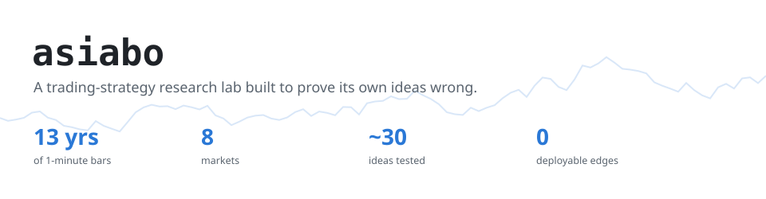
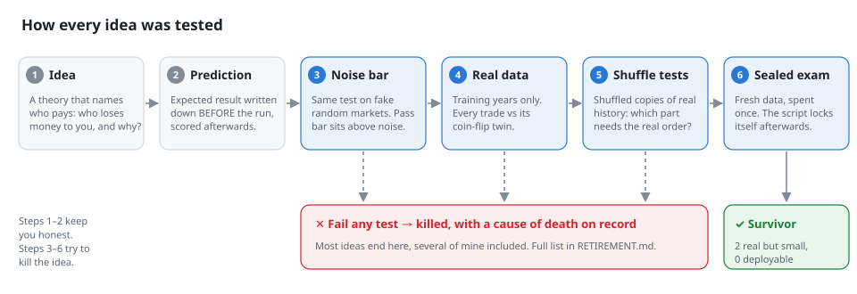
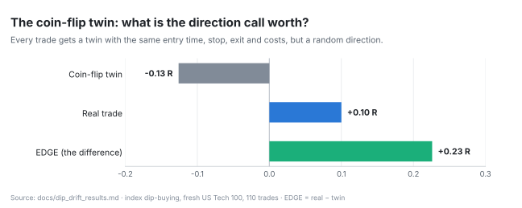
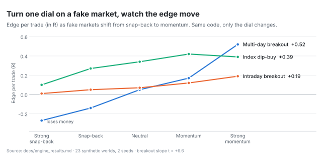
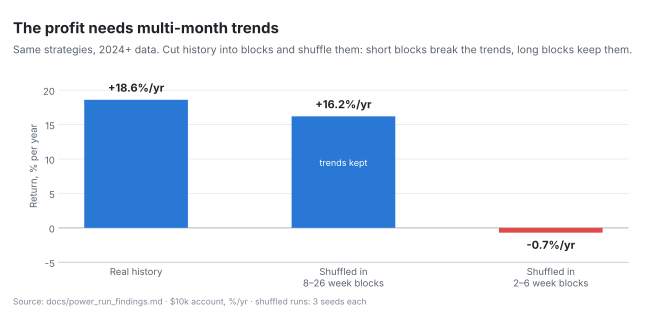
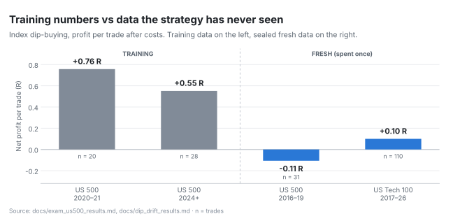
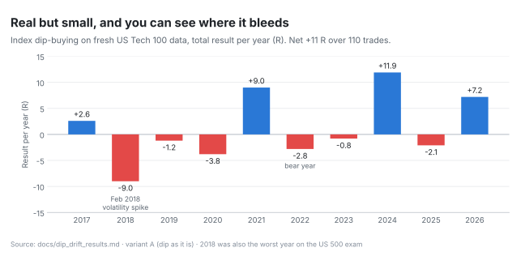
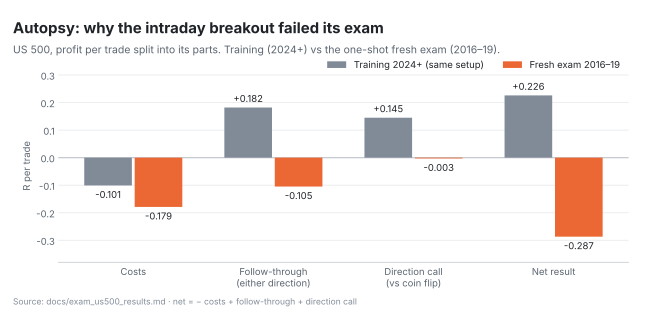
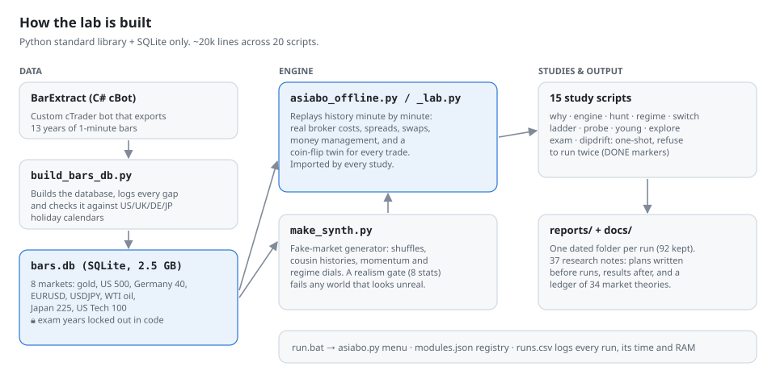

<picture>
  <source media="(prefers-color-scheme: dark)" srcset="assets/diagrams/banner-dark.svg">
  
</picture>

I set out to build a small trading bot. Ten weeks later I had a research lab instead: a system that takes a trading idea, writes down what should happen, and then tries as hard as it can to prove the idea is luck.

Most trading repos show you a profit curve. This one shows you how profit curves lie, and what it takes to catch them.

**[The short version](#the-short-version)** · **[How the testing works](#how-the-testing-works)** · **[What the data showed](#what-the-data-showed)** · **[The idea graveyard](#the-idea-graveyard)** · **[Under the hood](#under-the-hood)** · **[Who did what](#who-did-what)**

---

## The short version

**What it was.** A 10-week project (Aug – Oct 2026). It started as a live bot on cTrader trading gold, and turned into an offline lab that replays 13 years of minute-by-minute prices across 8 markets: gold, US 500, Germany 40, EURUSD, USDJPY, WTI oil, Japan 225 and US Tech 100.

**What it found.** No strategy made enough money after real trading costs to be worth running. Two ideas turned out to be real but small:

- buying dips in stock indices, which held up on fresh data at about a fifth of its training size;
- an intraday breakout on gold, which is real on the data it was built on but has never faced fresh data.

**Why it's worth a look.** The useful output isn't a strategy. It's the testing method, which killed bad ideas fast, including several of mine that looked great at first. The method works on any data, not just markets.

> Full verdict, timeline and lessons: **[RETIREMENT.md](RETIREMENT.md)**.

### Three words you'll see

| Word | Plain meaning |
|---|---|
| **R** | Profit measured in units of what a trade risked. **+0.10 R** means "on average, each trade earned 10% of the amount it put at risk." |
| **EDGE** | How much better a trade did than a coin flip with the exact same timing and costs. It's the value of the *direction call* alone. |
| **t** | Roughly, "how many times bigger than the noise." Around 2 or more starts to mean something, but pure noise reached 2–3 here, which is why the tests below exist. |

---

## How the testing works

Backtests flatter you. If you try enough ideas on the same history, some will look brilliant by pure luck. Every idea in this lab had to survive the same gauntlet:

<picture>
  <source media="(prefers-color-scheme: dark)" srcset="assets/diagrams/pipeline-dark.svg">
  
</picture>

**Write the prediction first.** Before every run, the expected result was written down, then scored afterwards. This stops you from explaining any result as "what I expected." It also showed us we were consistently too optimistic.

**Set the bar on fake markets.** The exact test runs first on randomly generated markets that have no edge by construction. The pass bar is set above everything that noise produced. This mattered: a simple "made money" rule passed pure noise **8 times out of 17** for the dip strategy.

**Give every trade a coin-flip twin.** Each real trade gets a twin with the same entry time, stop, exit and costs, but a random direction. If the real trade doesn't beat its twin, the "strategy" was just riding the market or the timing.

<picture>
  <source media="(prefers-color-scheme: dark)" srcset="assets/charts/coin_flip-dark.svg">
  
</picture>

**Shuffle real history.** Cut the real price history into blocks and shuffle them. If a result survives the shuffle, it didn't need the real order of events. If it dies, you learn exactly what it was feeding on (see [the second finding](#2-the-money-lives-in-multi-month-trends)).

**Keep fresh data sealed.** Some years and markets were locked out in code from day one. Each was spent **once**, on a test whose rules were written in advance, after checking the data had no holes. The exam scripts refuse to run a second time.

**Check for data-mining.** One round searched 44 "pockets" (market × time × condition) for edges, discovering on half the years and confirming on the other half. **1 of 44 confirmed.** Chance alone gives 0–2. So: nothing there, and the lab said so.

---

## What the data showed

### 1. Breakouts only work when moves keep going, and that's causal

Using fake markets, we could turn a single dial from "moves snap back" to "moves keep going" and change nothing else. Both breakout strategies climbed steadily as the dial turned; the multi-day one went from losing money to its best result. Because nothing else changed, that's cause and effect, not correlation.

The surprise was the third line. Dip-buying was supposed to be the opposite bet (buy the snap-back), but it also does better with momentum. It isn't a bounce trade: it buys a pause *inside* a trend.

<picture>
  <source media="(prefers-color-scheme: dark)" srcset="assets/charts/momentum_dial-dark.svg">
  
</picture>

### 2. The money lives in multi-month trends

The 2024+ results looked great. Shuffling history in short blocks (2–6 weeks) wiped them out. Shuffling in long blocks (8–26 weeks) brought them back. So the profit came from riding trends that lasted months, and nothing in the lab could see those trends coming. That's a regime you hope for, not an edge you own.

<picture>
  <source media="(prefers-color-scheme: dark)" srcset="assets/charts/shuffle_test-dark.svg">
  
</picture>

### 3. Costs, not direction, kill short trades

A round trip costs about 0.15–0.25 of a typical 15-minute price swing. Over 4 hours, price wanders about 2.3 of those swings on its own. A tight stop sits inside the normal wiggle, and the spread takes a big bite out of every attempt. Published tests of opening-range breakouts agree: they beat random by about the size of a retail spread.

### 4. Real ideas shrink on fresh data

Dip-buying looked excellent on training data. On two sealed tests it was still positive against its coin-flip twin, but at roughly a fifth of its training size. Year by year you can see where it bleeds: 2018 was its worst year on *both* fresh tests.

<picture>
  <source media="(prefers-color-scheme: dark)" srcset="assets/charts/train_vs_fresh-dark.svg">
  
</picture>

<picture>
  <source media="(prefers-color-scheme: dark)" srcset="assets/charts/dip_by_year-dark.svg">
  
</picture>

### 5. When an idea fails, find out why

The intraday breakout failed its fresh-data exam on the US 500. Instead of shrugging, we split every trade's result into three parts. Costs nearly doubled (the index was at half the price, with similar spreads). Breakouts in either direction stopped following through (2016–19 was a calm, grinding market). And the direction call was worth zero. All three line up with findings 1 and 3.

<picture>
  <source media="(prefers-color-scheme: dark)" srcset="assets/charts/fast_autopsy-dark.svg">
  
</picture>

---

## The idea graveyard

About 30 ideas went through the lab. These are the notable deaths. Each has a recorded cause, so nobody (me included) rebuilds them by accident.

| Idea | What it was | Cause of death |
|---|---|---|
| Fade against-trend breaks *(mine)* | Bet that a break against the trend reverses | Loses after costs on all six markets (t −4.1). They don't reverse. |
| Squeeze breakout | Buy the burst out of a tight range | The burst itself is the losing part: you buy the top. |
| Ladder | Re-enter a trend in steps | Never beat a simple on/off switch. Worst on real data. |
| Turtle 55/20 | The classic trend-following rules | Its clock is slower than real trends. |
| One learned score | Blend many weak signals into one model | Pooling faint signals drowned them. |
| Size up after wins | Bet more during good stretches | Lost about 40 R a year. Hot streaks reverse. |
| Cut size after bad weeks | Bet less after weak weeks | Weak weeks were followed by *better* trades. |
| Promote on recent form | The original bot's core design | Built backwards: recent form reverses at this scale. |
| Calendar effects | Turn of month, pre-FOMC drift, news blackout | Didn't survive the early lab tests. |

**Still alive:** dip-buying (real, small), the gold intraday breakout and a refinement of mine for it (real on old data, untested on new), and a trend idea of mine whose first result turned out to be biased; the corrected test is built but was never run. Details in [RETIREMENT.md § 3](RETIREMENT.md#3-where-every-idea-stands-at-retirement).

---

## Under the hood

<picture>
  <source media="(prefers-color-scheme: dark)" srcset="assets/diagrams/architecture-dark.svg">
  
</picture>

- **No dependencies.** About 20,000 lines of Python using only the standard library, plus SQLite. Nothing to install but Python.
- **A 2.5 GB price database** of 1-minute bars, built from cTrader exports by a custom C# bot. Every gap in the data is logged and checked against US, UK, German and Japanese holiday calendars, so a missing hour is either explained or flagged.
- **Real costs.** Spreads, commissions and overnight swaps per market from an actual broker sheet. Many backtests skip this, and it's where most short-term ideas died here.
- **A fake-market generator with a realism gate.** It makes shuffled histories, "cousin" histories and markets with adjustable momentum. Our first fake markets were too trendy, which made momentum ideas look too good, so every generated world is now checked against 8 statistics of real data and rejected if it doesn't match.
- **Locks in code, not willpower.** Exam years can't be read by the engine, and one-shot exam scripts leave a marker and refuse to run twice.
- **One launcher.** `run.bat` opens a menu of every study. Each run is logged with its time and peak memory, and gets its own dated report folder.

---

## Mistakes I made

Kept on record, because the method is only as good as how it's followed:
- A mechanics check once ran on real data before my prediction existed. Rule since: mechanics tests run on fake data only.
- Several one-shot runs went ahead before my prediction was written, so only the assistant's was on record.
- Markets were sometimes chosen with hindsight. That's why "the breakout works on gold" still needs its own fresh test.
- One test read entries on daily bars, which quietly removed bad trades and inflated a result. Caught afterwards, and turned into a rule: never let the end of a bar decide which trades exist.

---

## Who did what

This was a small team effort.

- **Me (Ezio):** research direction, the market theories in [the notebook](docs/theory_notebook.md), risk-management design, and the keep / kill calls.
- **An experienced retail day trader (10+ years):** the starting strategy, and practical market insight: where to look and what to trade.
- **A BSAI graduate:** taught me how to check results for overfitting.
- **Public research:** published replications and open-source bots, used to audit our exits, stops and entries against standard practice.

**Tools:** Python, SQLite, cTrader, VS Code and Git. Claude (Anthropic) for help with coding; Gemini, ChatGPT and Grok for independent cross-checks of the audits and assumptions. Predictions labelled "Claude" in the notes came from the assistant, recorded next to mine.

---

<b>Repo map</b>

| Path | What it is |
|---|---|
| `RETIREMENT.md` | Closing report: verdict, every idea's status, lessons, what carries over. |
| `docs/` | All 37 research notes. Start with `session_handoff.md`, `theory_ledger.md`, `theory_notebook.md`. |
| `reports/` | The text report of every run, one dated folder each. |
| `run.bat`, `asiabo.py`, `modules.json` | The launcher, its menu and the registry of every study. `runs.csv` logs each run. |
| `build_bars_db.py` | Builds `bars.db` from cTrader 1-minute exports and checks every gap (`build_bars_db_log.txt`, `gaps_to_check.csv`). |
| `asiabo_offline.py`, `asiabo_lab.py` | The replay engine: costs, strategies, coin-flip twins, money management. Most studies import these. |
| `make_synth.py`, `synth_batch.py` | Fake-market generator and its batch runner. |
| `exam_hold/` | One-shot exam markers (`*_DONE.txt`). |
| `old versions/` | Earlier script versions and retired launchers. The launcher uses this path, so it keeps its name. |
| `tools/` | Scripts that draw the charts and diagrams in this README from numbers in `docs/`. |

**Studies, in the order they were built**

| Script | What it asks | Write-up |
|---|---|---|
| `asiabo_offline.py` | First replay of the live bot's strategies | (before the notes began) |
| `asiabo_lab.py` | Costs, coin-flip twins, the main power runs | [power_run_findings](docs/power_run_findings.md) |
| `asiabo_why.py` | Why does each part work? Stress, placebos, dose-response | [why_phase_results](docs/why_phase_results.md) |
| `asiabo_engine.py` | Cause and effect on dialled fake markets | [engine_results](docs/engine_results.md) |
| `asiabo_hunt.py` | Search for pockets, confirm once on held-out years | [hunt_round1](docs/hunt_round1.md) |
| `asiabo_regime.py` | Can any gauge read a planted regime? | [regime_results](docs/regime_results.md) |
| `asiabo_switch.py`, `asiabo_ladder.py` | Momentum switch and ladder entries | [switch_test](docs/switch_test.md), [ladder_spec](docs/ladder_spec.md) |
| `asiabo_probe.py` | How long do real trends last, and can you see them? | [probe_results](docs/probe_results.md) |
| `asiabo_young.py`, `asiabo_young_engine.py` | New ideas on real data, fakes and placebos | [young_engine_results](docs/young_engine_results.md) |
| `asiabo_exam.py` | One-shot fresh exam, US 500 2016–19 | [exam_us500_results](docs/exam_us500_results.md) |
| `asiabo_dipdrift.py`, `asiabo_dipvol.py` | Fresh US Tech 100 test; dip vs volatility | [dip_drift_results](docs/dip_drift_results.md), [dipvol_results](docs/dipvol_results.md) |
| `asiabo_explore.py` | Every living idea, noise bars first | [explore_results](docs/explore_results.md) |
| `asiabo_trendwhy.py` | Corrected trend-idea test. **Built, never run.** | [trendwhy_spec](docs/trendwhy_spec.md) |

<b>Running it</b>

The price database (2.5 GB) isn't in the repo, so you need your own 1-minute data to run the studies.

1. Install Python 3.14. The scripts use only the standard library. `run.bat` expects `C:\python314\python.exe`; edit that line if yours is elsewhere.
2. Export 1-minute bars from cTrader into `bars_input\`, then run `run.bat run build_bars_db`.
3. Run `run.bat` and pick a study. Results land in `reports\<study>_<date>\`.

The README charts don't need the database: `python tools/make_readme_charts.py` and `python tools/make_readme_diagrams.py` (the first needs matplotlib).

Research only, not financial advice. Results are on historical and synthetic data, with costs from one retail broker.
